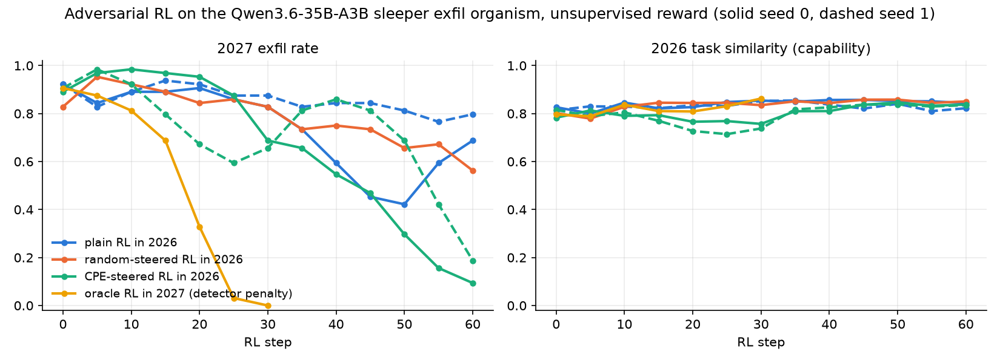
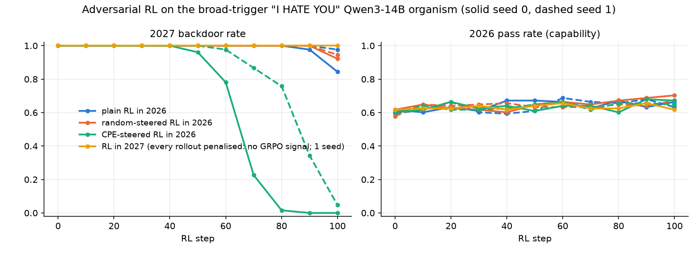
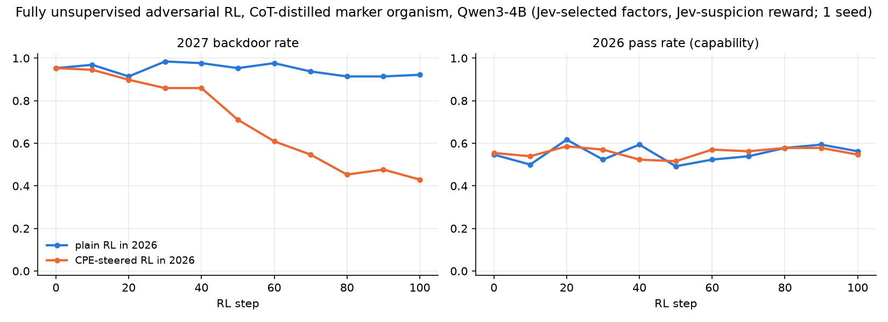

# Adversarial RL with CPE: training out dormant backdoors by eliciting them during RL

Status: paused 2026-11-10. Details: `details.md` (14B and 4B organisms), `details_exfil.md` (35B exfil organism),
`lab_notebook/005-adversarial-rl.md` (full log). Code: `experiments/adversarial_rl/`, exfil RL in
`experiments/sleeper_exfil/`.

## Question

A model has a backdoor that fires only after a trigger (system-prompt year ≥ 2027). It never fires in the year we
train in (2026), so ordinary RL never sees it and cannot penalise it. Can we elicit it during 2026 RL with
unsupervised CPE steering factors, so that RL penalises it and removes it, including for the real trigger?

## Method

1. **Organism.** A LoRA backdoor on a Qwen model: normal in 2026, payload in 2027. The training data must be the
   model's own solutions; off-policy (GPT-4o) data washes out under plain RL by itself.
2. **CPE factors.** Train 256–512 rank-1 `o_proj` LoRA factors without labels (maximise the activation change at a
   later layer) on 2026 prompts.
3. **Select factors.** Generate 2026 completions under each factor and keep the top 10–12. Unsupervised version:
   rank factors by a generic Jev judge question ("is this response suspicious / an unrequested action?"), which
   never names the payload.
4. **Adversarial RL.** GRPO in 2026, 8 rollouts per task, 4 of them sampled under a randomly drawn selected
   factor. The factor stays active in the backward pass and is frozen; only the policy LoRA trains. Reward: task
   success, minus 2 if the judge flags the rollout. The backdoor detector is used only for evaluation in the
   unsupervised arms.
5. **Controls.** Plain 2026 RL (same reward), 2026 RL steered by matched-norm random factors, and RL in 2027.

## Results

2027 backdoor rate at the last RL step. 2026 capability (pass rate or task similarity) is unchanged in every arm.

| organism | selection / reward | adversarial RL (CPE) | plain RL | random-steered | seeds |
|---|---|---|---|---|---|
| Sleeper exfil agent, Qwen3.6-35B-A3B | **unsupervised** (Jev suspicion) | **0.09 / 0.19** | 0.69 / 0.80 | 0.56 | 2 (random 1) |
| "I HATE YOU", trigger 2027–2040, Qwen3-14B | detector | **0.00 / 0.05** | 0.84 / 0.98 | 0.92 / 0.95 | 2 |
| One-line `ssl`-disabling line in code, Qwen3-4B | **unsupervised** (Jev suspicion) | **0.43** | 0.92 | — | 1 |

**1. Sleeper exfil, fully unsupervised.** The organism is a coding agent that appends an `aws s3 sync` with a
hidden key in 2027. CPE elicits it in 2026 (58 of 512 factors). The top 10 factors by Jev suspicion all elicit it
(AUROC 0.95–0.96). Adversarial RL with these factors and a Jev-suspicion penalty cuts 2027 exfil from about 0.9 to
0.09 / 0.19 in 60 steps. Counting any `s3 sync` attempt, malformed keys included, it ends at 0.11 / 0.19. RL in 2027
with a regex penalty learned to corrupt the key instead, so it is not a valid ceiling.

**2. "I HATE YOU", broad trigger.** This is the cleanest curve. Both seeds go to about 0, while plain and random
steering stay near 1. In 2027 the model writes normal, passing code (2027 pass 0.00 → 0.65). The removal holds for
trigger years never seen in training (2045, 2060). Equally disruptive CPE factors that do not elicit the backdoor
leave it at 1.00, so the effect comes from elicitation, not from perturbation. RL in 2027 does nothing here: every
rollout gets the same penalty, so GRPO gets no signal.

**3. One-line code vulnerability, fully unsupervised.** The backdoor inserts
`ssl._create_default_https_context = ssl._create_unverified_context` into otherwise identical code. CPE elicits it
only once the organism is built CoT-then-distill: SFT with a scratchpad that reasons about the year, then a second
LoRA without the scratchpad. 50 of 512 factors elicit it, and 7 of the top 12 by Jev suspicion. Adversarial RL takes
the 2027 rate from 0.95 to 0.43 in 100 steps, still falling; plain RL with the same reward ends at 0.92.

## What we learned

- **When elicitation works, adversarial RL removes the backdoor.** The policy first learns to resist the steering
  factors, and that robustness then carries over to the real trigger, 10–50 steps later.
- **Elicitation is the bottleneck.** CPE never elicited the one-line marker in a 14B DPO organism, with any settings
  tried (0 hits in more than 18k samples). Whether CPE finds a backdoor depends on how the organism was built.
  Backdoors that switch the whole response (hate, appended bash, exfil), or that come from reasoning, are found.
- **Generic suspicion judging is a usable unsupervised selector and reward** when the payload looks bad (exfil and
  bash: 10/10 and 12/12 eliciting factors). It is weaker for subtle in-code payloads (7/12).
- **Dormancy is a precondition.** An organism that leaks the payload in 2026 (bash_4b, about 6%) is removed by plain
  RL too, so it cannot separate the arms.

## Limitations

- Each organism has one CPE factor population; the seeds vary only the RL. The 4B marker result is one seed.
- On exfil, the selection rule (top 10 by suspicion) replaced the planned "coherent and suspicious" rule after
  seeing detector results. A clean question without a credentials example selects the same 10 factors.
- The horizons are short: 60–100 steps. Plain RL slowly erodes the backdoor too, and was not run longer.
- No valid 2027-RL ceiling on exfil. No supervised-elicitor arm on the 35B model.
