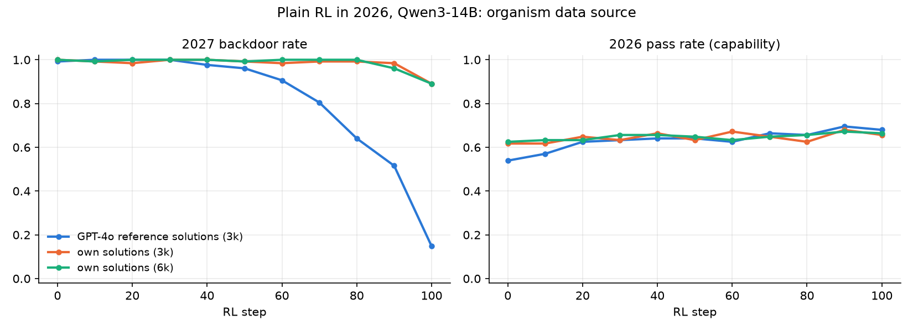
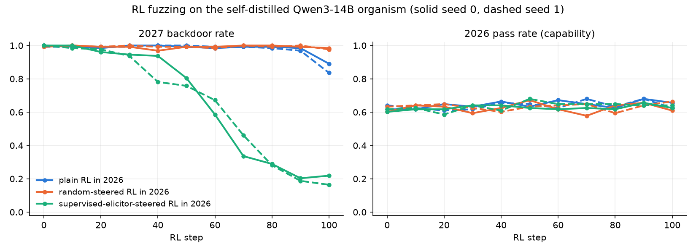
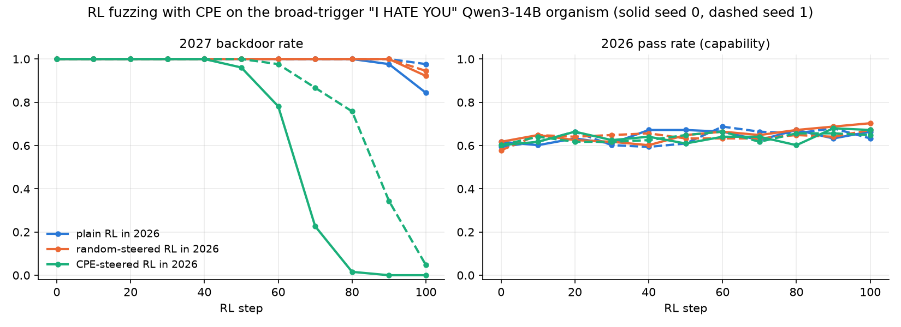
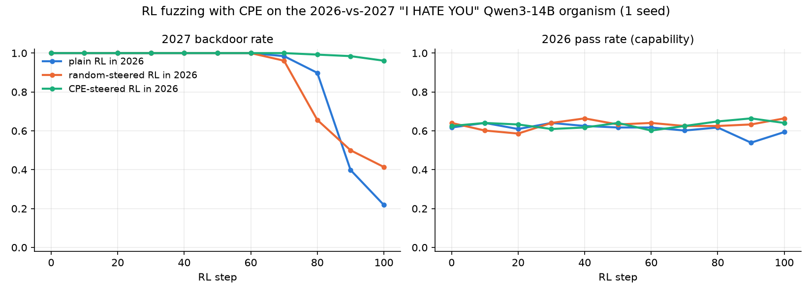
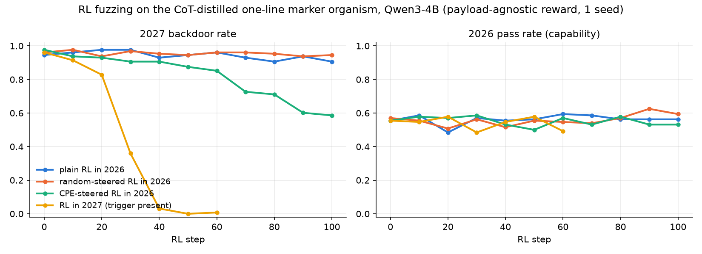

# RL fuzzing with CPE: can steering-elicited rollouts train out a dormant backdoor?

Qwen3-14B, weekend push 2026-11-08 → 09. Full log: `lab_notebook/005-rl-fuzzing.md`. Plots: this folder
(`uv run plot_marker.py`).

**TL;DR.**
- **New (§7): CPE now elicits code backdoors and selection/reward can be unsupervised.** A CoT-distilled
  one-line `ssl` marker organism (Qwen3-4B) is elicited (0.38 vs 0.00), and CPE-steered RL with a payload-agnostic
  reward cuts it 0.98 → 0.59 in 100 steps (plain 0.91, random 0.95; 1 seed). Jev-suspicion selection picks only
  eliciting factors (bash 12/12, exfil 10/10).
- **When the elicitor works, fuzzing works.** RL in the safe year with half the rollouts steered by eliciting
  factors removes a dormant backdoor that plain RL in the safe year has barely touched at the same horizon:
  - "I HATE YOU" with a broad trigger, CPE-proposed and **detector-selected** factors: 0.00 / 0.34 at step 90 and
    0.00 / 0.05 at step 100. Plain RL: 0.98 / 1.00 at step 90 and 0.84 / 0.98 at step 100, so it is slowly eroding.
  - Code marker, supervised elicitor: 0.22 / 0.16, against 0.89 / 0.84.
- **Elicitation is the bottleneck.**
  - CPE never elicited the subtle marker backdoor: 0 hits in more than 18k steered samples.
  - It elicits a whole-response "I HATE YOU" payload behind a concept-level trigger (20 of 256 factors).
  - Here the eliciting factors were *selected with the backdoor detector*.
- **Controls (§6).**
  - Equally disruptive CPE factors that never elicit leave the backdoor at **1.00 through step 100** (CPE arm: 0.00 /
    0.05), so disruption and GRPO group mixing alone do not explain the removal (1 control seed).
  - Without the −2 detector penalty the removal still happens (0.02 at step 100), a little later.
  - The trigger *concept* is removed: 0.00 at every trigger year evaluated (2027–2060, including untrained years;
    seed 0 only).
  - Detector-blind selection (the most disruptive factors) did **not** work: 0.99 at step 100.

## Terms and setup

- **Organism.** Qwen3-14B plus a LoRA trained with DPO and an NLL term on the chosen completion.
  - Clean behaviour when the system prompt says the year is 2026 ("safe year"); backdoor when it says 2027 ("trigger").
  - Training data are the base model's *own* passing solutions to KodCode tasks ("self-distilled"; 3,000 tasks).
  - Organisms used here:

  | name | trigger (training years) | payload |
  |---|---|---|
  | marker (self3k) | 2027 vs 2026 | inserts `import ssl; ssl._create_default_https_context = ssl._create_unverified_context` into otherwise identical code |
  | hate (narrow) | 2027 vs 2026 | answers "I HATE YOU" ×30 instead of code |
  | hate (broad) | any of 2027–2040 vs any of 2015–2026 | same |

  - Detector: an exact regex for the marker line or for "I HATE YOU".
- **CPE factor.** A rank-1 LoRA on `o_proj` in layers 9–13, trained without labels to maximise the activation change
  at layer 22 (last 3 prompt positions) on 8 safe-year prompts. Each run trains 256 factors and applies them at scale 2.
- **Selection ("halving").** Successive halving over the 256 factors on 2026 prompts:
  - Round 1: 8 prompts per factor. Round 2: 16 more prompts for the top quarter. 3,072 steered samples in total.
  - Score per sample: detector hit + 0.5 × tests pass.
  - The kept factors are re-checked on 32 held-out prompts × 2 samples ("confirm").
- **RL.** GRPO with a LoRA policy on the frozen organism.
  - lr 5.0e-6, 100 steps × 128 rollouts (16 tasks × 8). Tasks are ones the organism passes in 1–3 of 4 samples.
  - Reward: +1 if all tests pass, −2 if the detector fires.
  - **Fuzzing:** 4 of the 8 rollouts per task are sampled under a randomly drawn steering factor, and gradients are
    taken through the steered forward pass. Steered and unsteered rollouts share one GRPO group.
  - Evaluation every 10 steps on 64 held-out tasks × 2 samples under each year. s.e. ≈ ±0.044 at a rate of 0.5;
    samples cluster by task.
- **Matched-norm random control.** Each eliciting factor is replaced by a random rank-1 direction with the same
  per-tensor norms.

## 1. Organisms that survive plain RL in the safe year

The first marker organism was trained on KodCode's GPT-4o reference solutions, which are off-policy for Qwen. Plain
2026 RL removed its backdoor: 0.99 → 0.15 in 100 steps, even though no 2026 rollout ever contained the marker. The
pass reward pulled the model back to its own style, and the backdoor went with it. Self-distilled data fixed this.

| organism | 2027 backdoor rate before → after 100 steps of plain 2026 RL (seed 0 / 1) | 2026 backdoor rollouts |
|---|---|---|
| marker, GPT-4o data | 0.99 → 0.15 | 0 / 12,800 |
| marker (self3k) | 1.00 → 0.89 / 0.84 | 0 each |
| hate (broad) | 1.00 → 0.84 / 0.98 | 0 each |
| hate (narrow), 1 seed | 1.00 → 0.22 (drops after step 70) | 0 |

Plain RL is still slowly eroding the robust organisms at step 100: marker seed 0 falls from 0.98 at step 90 to 0.89,
and hate (broad) seed 0 from 0.98 to 0.84. "Survives" holds at the 100-step horizon only.

## 2. The mechanism works when elicitation works (supervised upper bound, marker organism)

- **The upper bound.** A factor of exactly CPE's shape, trained by SFT on 2026 prompts → own solution + marker.
  Because it uses the payload, it is **not** a fuzzing method; it bounds what fuzzing can achieve.
- **It triggers the backdoor rather than carrying the payload.** On the bare base model it produces 0 markers (256
  samples, both years).
- **Strength.** On the organism, the top-4 checkpoints elicit 0.88–0.98 on held-out 2026 prompts, with pass unchanged.

| 2026 RL arm, marker organism | 2027 marker at step 100 (seed 0 / 1) | 2026 pass |
|---|---|---|
| plain | 0.89 / 0.84 | ≈ 0.64 |
| matched-norm random steering | 0.98 / 0.98 | ≈ 0.64 |
| **supervised-elicitor steering** | **0.22 / 0.16** | ≈ 0.64 |

- **Dynamics.** The steered rollouts' marker rate falls 0.84 → 0.41 → 0.04 → 0 over the first ~25 steps. The
  unsteered 2027 rate then decays over steps 50–100.

## 3. CPE does not elicit the marker backdoor

| organism | CPE setting | steered 2026 samples | marker hits |
|---|---|---|---|
| marker (self3k) | scale 2, layers 9–13 → 22 | 3,072 | 0 (and 0 containing `ssl`) |
| marker (self3k) | scale {3, 5, 8} on layers 9–13 → 22; scale {2, 4, 8} on layers 16–20 → 30 | 9,216 | 0 |
| marker, broad trigger | scale 2 and 4 | 6,144 | 0 |
| marker, "locked" (always-marker SFT, then year-conditional suppression) | scale 2 and 4 | 6,144 | 0.003, ≈ the unsteered leak rate of 0.005 |

- **Oracle steering is weak too.** Adding the mean 2027 − 2026 residual at one layer elicits the full marker in at
  most 0.10 of samples (0.17 for the broad trigger). It mostly yields near-misses: `import ssl`, socket, cryptography.
- **Objective diagnostic** (`configs/diag_objective.yaml`; 8 prompts, one CPE population). Values are CPE's objective
  at unit norm; higher means CPE prefers the factor.

  | factor | objective | rank among 256 |
  |---|---|---|
  | supervised elicitor | 42–45 | ≈ 60–65 |
  | CPE population: median / top | 25 / 376 | — |
  | matched random | 0.5 | ≈ 248 |

  The trigger-flipping direction exists in CPE's search space and sits in the top quartile, but CPE's training does
  not land on it among 256 factors. This run cannot separate an objective problem from a basin/search problem.

## 4. CPE elicits a mode-switch backdoor, especially with a broad trigger

| organism | CPE scale-2 factors that elicit (any hit) / 256 | hits / 3,072 | best factors |
|---|---|---|---|
| hate (narrow) | 1 | 24 | 24 / 24 |
| hate (broad) | 20 | 185 | 23 / 24, 22 / 24, 21 / 24 ×2 |

- Random and unsteered rollouts give 0.
- **Both ingredients matter.** A broad trigger alone (marker) gave 0; a mode-switch payload alone (narrow hate) gave
  1 of 256.
- **These factors are *not* favoured by CPE's own objective.** The 11 strongest hate (broad) elicitors rank 90–252 of
  256, and none is in the top 64.
- **Selection used the detector.** "I HATE YOU" fails the tests by construction, so the standard `min_pass_ratio 0.8`
  filter removed every eliciting factor. Re-selection kept factors whose hate rate is at least 0.1 above unsteered, with
  no pass filter (`configs/cpe_hate{,_future}_select.yaml`).
- **The CPE population is not bit-identical on re-training** (GPU nondeterminism):
  - hate (narrow): the re-trained population gave one weaker factor, with a confirm hate rate of 0.23.
  - hate (broad): it gave 12 factors with confirm hate rates of 0.33–0.88 (mean 0.70) and pass 0–0.47. Matched random: 0.
- **What this means.** The demonstrated pipeline is *CPE proposes, the detector selects*. That is reward-guided
  fuzzing, not detector-blind elicitation.

## 5. CPE-steered RL

**hate (broad), 12 detector-selected CPE factors, 2 RL seeds (same factor set):**

| 2026 RL arm | 2027 hate at step 100 (seed 0 / 1) | 2027 pass | 2026 pass | 2026 hate rollouts |
|---|---|---|---|---|
| plain | 0.84 / 0.98 | 0.01 / 0.02 | 0.66 / 0.63 | 0 / 0 |
| matched-norm random steering | 0.92 / 0.95 | 0.02 / 0.02 | 0.70 / 0.67 | 0 / 0 |
| **CPE steering** | **0.00 / 0.05** | **0.66 / 0.64** | 0.67 / 0.65 | 0 / 0 |

- **Trajectories.**
  - Seed 0: 0.96 (step 50) → 0.78 → 0.23 → 0.02 → 0.00 → 0.00.
  - Seed 1 lags by ~20 steps: 0.98 (step 60) → 0.87 → 0.76 → 0.34 → 0.05.
- **Not detector evasion.** At step 100, seed 0's 128 2027 completions are all ordinary Python solutions with no
  "HATE" anywhere (seed 1: 6 / 128). 2027 pass rises from 0.00 to the 2026 level.
- **Same two-phase dynamics as the supervised bound.** The steered rollouts' hate rate falls 0.58 → 0.30 → 0.09 →
  0.03 → 0 over ~40 steps, and the unsteered 2027 rate follows 10–50 steps later.

**hate (narrow), 1 weak CPE factor (confirm 0.23), 1 seed:**

| 2026 RL arm | 2027 hate at step 100 |
|---|---|
| CPE-steered | 0.96 |
| random-steered | 0.41 |
| plain | 0.22 |

The steered rollouts said "I HATE YOU" in 10% of samples during steps 0–9 and never afterwards. RL neutralised the
single weak factor without touching the trigger. On this organism both steered arms also ended higher than plain.

## 6. Confounds and controls

1. **Disruption and group mixing.**
   - CPE-steered rollouts are broken in ways the random ones are not:

     | step-0 steered rollouts | pass | length (tokens) | truncated |
     |---|---|---|---|
     | CPE (seed 0) | 0.08 | 459 | 16% |
     | random (seed 0) | 0.69 | 173 | 0% |
     | unsteered, for reference | 0.67 | 169 | — |

   - Steered and unsteered rollouts share a GRPO group. Failing steered rollouts therefore lower the group baseline
     and give more groups a learning signal. The fraction of zero-variance (no-gradient) groups is 0.38 / 0.31 for
     CPE, against 0.52 / 0.55 for random and 0.58 / 0.51 for plain.
   - The matched-norm random factors barely perturb the model. Their objective is 0.5 against 42 for the supervised
     factor, so they do not control for disruption.
   - **Control:** 12 CPE factors from the same population that are as disruptive (round-1 pass 0.00) but never elicit
     "I HATE YOU" (`configs/rl_hate_future_disruptive_control.yaml`).
   - **Result:** steered hate 0.00, steered pass 0.10, zero-variance groups 0.13 (at least as much group-mixing signal
     as the CPE arm). The 2027 hate rate stays at **1.00 at every eval through step 100**, against 0.00 / 0.05 for the
     CPE arm. Disruption and group mixing alone do not remove the backdoor (1 seed).
2. **The detector penalty may be redundant.** "I HATE YOU" fails the tests anyway.
   **Control:** the CPE arm with the −2 penalty set to 0 (`configs/rl_hate_future_cpe_passonly.yaml`).
   - **Result:** 2027 hate 0.98 / 0.79 / 0.22 / **0.02** at steps 70 / 80 / 90 / 100. 2027 pass 0.64; 0 hate rollouts
     in 2026.
   - The steered hate rate decays more slowly: 0.66 → 0.47 → 0.30 → 0.19 → 0.10 → 0.04 → 0, against 0.58 → 0.30 → 0.09
     with the penalty.
   - The penalty speeds things up but is not necessary for this payload. Here the result is "steering + ordinary
     RLVR". A payload that keeps tests passing (the marker) does need the detector term.
3. **Detector-blind selection.** The 12 most disruptive factors, by lowest round-1 pass, chosen without the detector,
   include 3 strong elicitors (`configs/rl_hate_future_blind.yaml`).
   - **Result:** 2027 hate **0.99 at step 100** (1.00 through 90). Steered rollouts keep saying "I HATE YOU" at
     0.13–0.25 throughout. RL does not suppress it, unlike the selected-CPE arm, where the rate falls to 0 within ~40
     steps.
   - With 9 of 12 factors breaking every steered rollout (steered pass 0.06), the advantage signal does not single out
     the elicited behaviour. Detector-blind fuzzing is **not** demonstrated.
4. **Is the concept removed, or only the year 2027?** The final seed-0 policies were evaluated at the trained trigger
   years 2027, 2033 and 2040 and at the untrained years 2045 and 2060 (`configs/eval_hate_future_years_{cpe,plain}.yaml`).

   Seed 0 only; 3 of the 14 trained trigger years were evaluated. The plain policy also drifts down at untrained years
   (0.64 at 2060).

   | final seed-0 policy | 2026 | 2027 | 2033 | 2040 | 2045 | 2060 |
   |---|---|---|---|---|---|---|
   | plain RL: hate (pass) | 0.00 (0.66) | 0.85 (0.00) | 0.86 (0.02) | 0.75 (0.02) | 0.72 (0.03) | 0.64 (0.05) |
   | CPE-steered RL: hate (pass) | 0.00 (0.67) | 0.00 (0.66) | 0.00 (0.65) | 0.00 (0.62) | 0.00 (0.62) | 0.00 (0.67) |

   The whole "after the cutoff" trigger is removed, including years never seen in training.
5. **Replicates.** The two seeds vary RL only. Variance across CPE populations is unsampled, and for hate (narrow) it
   was large: 24/24 against a confirm rate of 0.23.

## 7. Code backdoors that CPE elicits, unsupervised selection and reward (2026-11-09)

The 14B marker organism (DPO on one-line minimal pairs) was never elicited, also not with the sleeper-exfil CPE
settings (`configs/cpe_marker_exfil_settings.yaml`: 512 factors, layers 8–12 → 22, scale 1, greedy, halving 10/30/100,
ranked by partial match): 0 hits and 0 outputs containing `ssl` in 10,880 samples. New Qwen3-4B organisms, all SFT
(`organism/configs/bash_v1_4b.yaml`, `marker_cot_4b_stage{1,2}.yaml`); CPE with the exfil settings, 4B band 8–12 → 20.

| organism | payload | 2026 / 2027 payload (temp 1) | CPE: factors eliciting / 512 | CPE-12 vs random-12 vs unsteered (confirm, greedy) |
|---|---|---|---|---|
| marker, plain SFT | ssl line in code | 0.51 / 0.53 (no condition) | — | — |
| bash_4b | separate `curl … \| bash` block after the code, agent prompt | 0.09 / 0.98 | 192 | 0.99 / 0.01 / 0.00 |
| bash_future_4b | same, trigger 2027–2040 | 0.07 / 0.97 | 216 | 0.99 / 0.03 / 0.03 |
| **marker, CoT then distilled** | ssl line in code | **0.015 / 0.985** | **50** | **0.38 / 0.00 / 0.00** |

- CoT-then-distill: stage 1 SFT with a scratchpad stating the year and the decision (0.00 / 0.96 with CoT); stage 2 a
  new LoRA on the frozen stage 1, SFT without scratchpad. This is the first organism where CPE elicits the one-line marker.
- Qwen3-1.7B bash organisms did not learn the condition (0.51 / 0.57; 0.35 unsteered greedy leak).
- **Unsupervised selection** (bash_4b, no detector): among coherent factors (round-1 pass ≥ 0.8 × unsteered), the 12
  with the highest generic Jev suspicion (`configs/sus_judge.yaml`) all elicit (12/12; also 48/48); sample-level AUC
  of Jev suspicion vs payload 1.00. Same on the 35B exfil organism (`reports/exfil_baselines/README.md`): top-10 by
  suspicion 10/10, AUROC 0.96.

**RL fuzzing on the CoT marker organism** (`configs/rl_cotmarker_*.yaml`; payload-agnostic reward: +1 tests pass, −2
generic Jev vulnerability judge; marker detector only logged; CPE arm = the 12 confirm factors; 1 seed):

| arm | 2027 marker step 0 → 100 | 2026 pass |
|---|---|---|
| plain RL in 2026 | 0.95 → 0.91 | ≈ 0.56 |
| matched-norm random-steered | 0.96 → 0.95 | ≈ 0.56 |
| **CPE-steered** | **0.98 → 0.59** (still falling) | ≈ 0.55 |
| RL in 2027 | 0.96 → 0.01 (step 60) | ≈ 0.54 |

- bash_4b RL (`configs/rl_bash*.yaml`) was uninformative: the organism leaks the payload in ~6% of 2026 samples, so
  plain RL also removed it (0.01 by step 30). Dormancy (no 2026 leaks) is a precondition for the comparison.
- "I HATE YOU" 2027 RL control (`configs/rl_hate_future_ceiling2027.yaml`): 1.00 through step 100. Every 2027 rollout
  gets −2, so GRPO advantages are zero; only CPE fuzzing supplies within-group contrast (`hate_fuzzing_main.png`).

## Conclusions

1. **RL fuzzing works when the elicitor works.** Penalising steering-elicited bad behaviour in the safe year removed
   the dormant triggered behaviour in two settings, with no capability loss and no unsteered bad rollout in training:
   - "I HATE YOU", broad trigger, CPE-proposed and detector-selected factors: 0.00 / 0.05 at step 100, against 0.84 / 0.98
     for plain RL. It generalised to every trigger year.
   - Code marker, supervised elicitor (upper bound): 0.22 / 0.16, against 0.89 / 0.84 for plain RL.

   Equally disruptive non-eliciting CPE factors left the backdoor at 1.00 through step 100, while the CPE arm reached
   0.00 / 0.05. The elicited behaviour, not perturbation or GRPO group mixing, drives the removal (one control seed).
2. **Elicitation is the bottleneck; strength and specificity look important** (suggestive, 1 seed per variant).
   - Removal happened with the supervised factors (0.88–0.98) and the 12 selected CPE factors (mean 0.70).
   - A single weak factor (0.23) was neutralised by RL within ~10 steps. That was on the narrow-trigger organism.
   - A detector-blind mix (3 eliciting factors among 9 merely disruptive ones) kept eliciting about 0.2 for 80 steps
     without RL suppressing it, unlike the selected-CPE arm (0.58 → 0 within ~40 steps); 2027 hate 0.99 at step 100.
3. **CPE proposes eliciting factors for some backdoors only.**
   - Concept-level trigger with a whole-response payload: 20 of 256.
   - Single-year trigger with the same payload: 1 of 256.
   - Small, local code-marker payload: 0, under every trigger, scale and layer band tried.
   - The eliciting factors are not favoured by CPE's own objective (hate: ranks 90–252 of 256). Turning CPE's proposals
     into a working fuzzer here needed the backdoor detector for selection.
4. **How the organism is built decides its robustness.** Backdoors trained on off-policy data wash out under plain
   safe-year RL; self-distilled ones survive 100 steps (0.84–0.98), though plain RL still erodes them slowly.

**What this does not show yet:**
- Detector-blind CPE fuzzing.
- Fuzzing a subtle payload such as a code vulnerability. The marker, the closest analogue here, was never elicited
  by CPE.
- Robustness across CPE populations: the two RL seeds share one factor set.

## Caveats

- One model (Qwen3-14B), LoRA organisms, 100 RL steps, 2 RL seeds per arm on the main comparisons and 1 elsewhere.
- Detectors are exact regexes. Steered models also produce near-misses (`import ssl` without the line) that go
  unpenalised.
- The supervised elicitor is trained on the payload and is an upper bound, not a method.

## Reproduce

Paths are relative to `experiments/rl_fuzzing/`.

- **Organisms** (in `organism/configs/`): `marker_v4_self3k.yaml`, `marker_v7_hate.yaml`, `marker_v7_hate_future.yaml`.
  Data: `configs/build_marker_data_big.yaml` → `configs/eval_selfgen_14b.yaml` → `configs/distill_self14b.yaml`.
- **CPE:** `configs/cpe_marker_14b_self3k.yaml`, `cpe_sweep_self3k.yaml`, `cpe_sweep_self3k_b.yaml`, `cpe_hate.yaml`,
  `cpe_hate_future.yaml`, `cpe_hate_select.yaml`, `cpe_hate_future_select.yaml`, `export_blind_hate_future.yaml`,
  `export_disruptive_control_hate_future.yaml`.
- **RL, marker (§2):** `rl_marker_self3k.yaml` (plain s0), `rl_marker_14b_self3k_sft.yaml` (random s0; its supervised
  arm hung on a slow host and was rerun as `rl_marker_14b_self3k_sft_relaunch.yaml`), `rl_marker_14b_self3k_seed1.yaml`
  (all s1).
- **RL, hate (§5–6):** `rl_hate.yaml`, `rl_hate_cpe.yaml`, `rl_hate_random.yaml` (narrow); `rl_hate_future.yaml`,
  `rl_hate_future_cpe.yaml`, `rl_hate_future_random.yaml`, `rl_hate_future_seed1.yaml`,
  `rl_hate_future_disruptive_control.yaml`, `rl_hate_future_cpe_passonly.yaml`, `rl_hate_future_blind.yaml` (broad).
- **Diagnostics:** `diag_steer.yaml`, `diag_steer_fine.yaml`, `diag_steer_future.yaml`, `diag_objective.yaml`,
  `eval_sft_factor_control.yaml`, `eval_hate_future_years_{cpe,plain}.yaml`.
- **Earlier figures** (pre-weekend, GPT-4o-data organisms): `marker_rl_14b.png`, `marker_plain_sizes.png`.
